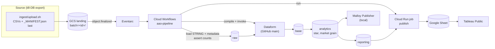

# Against All Odds – BI case

KPIs, data platform and dashboard for AAO's Premier League 2024/25 betting data.
Plan, KPI definitions and decisions: [PLAN.md](PLAN.md). Short decision records: [docs/adr/](docs/adr/).

## Architecture

| Layer | Contract |
|---|---|
| `raw` | Append-only copy of each landed file. All STRING + `_batch_id`, `_ingested_at`, `_source_file` |
| `base` | Typed, cleaned, latest row per key. Results derived from `match_results` (joined on teams, never dates) |
| `analytics` | Star schema at market grain: `dim_fixture`, `dim_market`, `dim_option`, `dim_date`, `fct_bets`, `fct_option_daily`, `fct_market_outcome`, `fct_market` |
| `reporting` | Tables shaped for the dashboard: `rpt_kpi_totals`, `rpt_market_summary`, `rpt_option_cumulative`, `rpt_crosscheck`, `dq_bets_after_actual_match` |

## KPIs (AAO's side)

| KPI | Value (as of 2024-10-16) |
|---|---|
| Settled earnings | 603,336.49 |
| Settled margin | 6.33 % |
| Open bets | 16,105,242.00 |
| Worst case future earnings | −862,723.87 |
| Best case future earnings | 3,953,923.70 |

Definitions in PLAN.md §3. Reproduced independently by `checks/oracle.py`, the Dataform models, and the Malloy model.

## How it is checked

`make verify` is the definition of done:

| Stage | What |
|---|---|
| `oracle` | Independent DuckDB implementation → `checks/golden/`, must hit the reference numbers and 70/70 results |
| `compile` | Dataform compiles, graded and scenario |
| `lint` | shellcheck, Workflow YAML |
| `local-full` | The compiled Dataform graph on DuckDB over the real batches (batch 1, O/U batch, scenario push): all assertions, diff vs golden, graded numbers unchanged by O/U and scenario |
| `malloy-check` | The Malloy model on the same marts vs golden |
| `verify-cloud` | BigQuery `reporting.*` vs golden, Sheet vs BigQuery (skipped, loudly, until set up) |

## Run it

1. `data/`: `fixtures.csv`, `markets.csv`, `options.csv`, `extra.csv` are in the repo. Copy `bets.csv` (49 MB, not in git) in from the case material.
2. Tools: `uv`, Node (`npx`), `jq`; for the cloud part also `gcloud`/`bq` and `gh`.
3. `make verify` works without any cloud setup.
4. Cloud: `make wizard` (human steps, resumable) → `make setup` → `make wizard` again (share the Sheet) → `make upload` → `make verify`.

| Command | |
|---|---|
| `make upload` | Batch 1, waits for the pipeline |
| `make upload-ou` | Batch 2: Over/Under 2.5 markets (no bets). Graded KPIs must not move |
| `make scenario` / `make scenario-reset` | Season over in `*_scenario` datasets, then drop them |
| `make malloy` | Malloy Publisher on http://localhost:4000, packages `aao` and `aao_scenario` |
| `make help` | Everything else |

## Layout

| Path | What |
|---|---|
| `infra/` | `wizard.sh` (human steps), `setup.sh` (idempotent gcloud), `env.sh` (resource names) |
| `ingest/` | `upload.sh`, `prepare_batch.py`, `make_ou_batch.py`, `workflow.yaml` |
| `workflow_settings.yaml`, `definitions/`, `includes/` | Dataform project (at the repo root: Dataform compiles from the root of the connected git repo) |
| `publish/` | Cloud Run job: `reporting.*` → Google Sheet |
| `malloy/` | Semantic model (`aao/aao.malloy`), Publisher config generator, local check |
| `checks/` | Oracle, golden files, local Dataform runner, cloud verify |
| `docs/` | ADRs, production notes. `explore_bets_original.malloy` is the pre-case exploration, kept as the "before" (its earnings formula is wrong, PLAN.md §3) |
